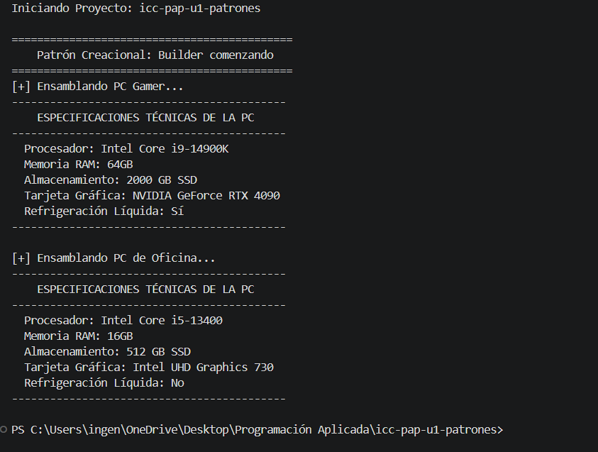

## Patrón de Diseño Creacional: Builder

En este patrón nosotros tenemos que crear una clase (si tenemos una clase solamente colocar "class Computadora") con un constructor privado que sea de tipo Builder esto es obligatorio en este patrón.

Entonces le especificamos al constructor que debe ser de tipo Builder, junto con una clase static Builder anidada, donde colocamos setters tomando en cuenta que los atributos o información cambiarían al momento de instanciar, por último un método el cual le permite verificar que no entren datos vacíos como el procesador (usando el ejemplo de mi Clase Computadora), en el Builder demo instanciamos dándole datos a cada atributo, en el App hacemos un public static void runBuilder(), para hacer la ejecución en el public static main

